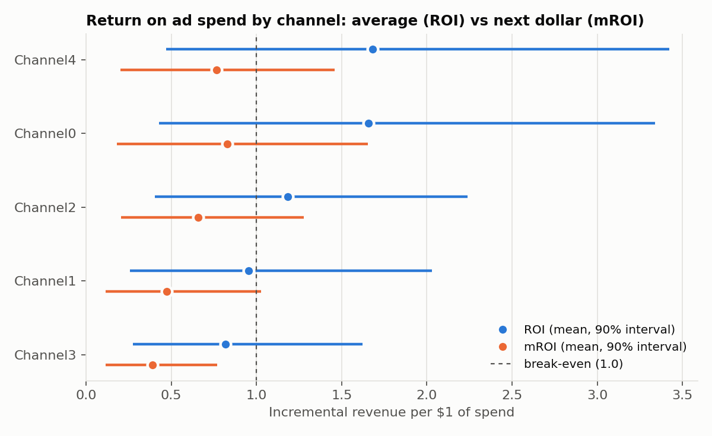
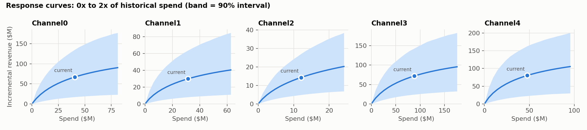
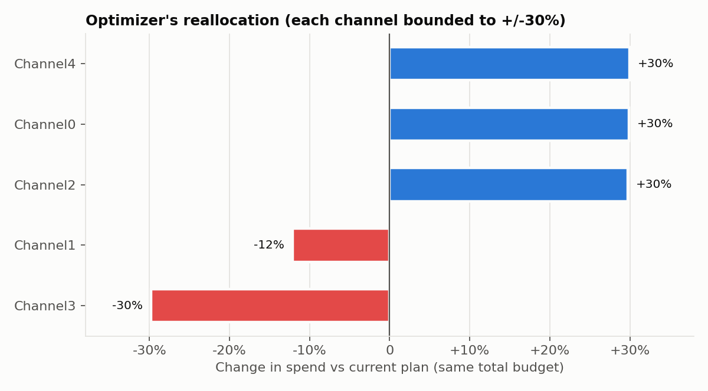
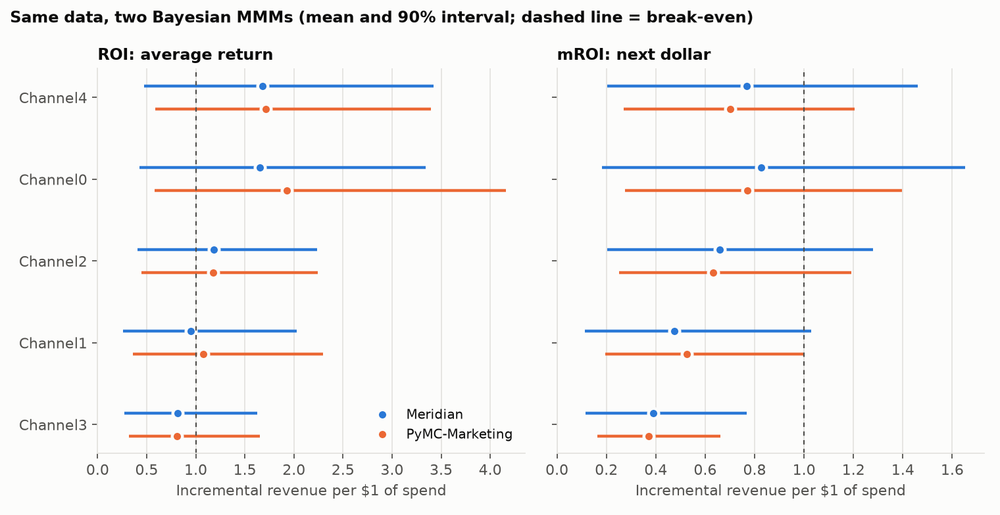

# Meridian MMM case study: where should the next ad dollar go?

A marketing-mix model built with [Google Meridian](https://github.com/google/meridian) on Meridian's own simulated dataset, read out the way a finance team would: channel ROI against marginal ROI, a 10% budget reallocation, Meridian's budget optimizer, and whether the last 10% of the budget pays for itself.

```bash
make install && make all   # full fit ~16 min on an Apple M1 Pro CPU, then ~3.5 min of analysis
make test                  # 30 tests: scenario mechanics, data checks, consistency of the published numbers
```

> Independent educational project. The data are **simulated** (Meridian's `geo_all_channels.csv`), so no number here describes a real advertiser. Not investment or marketing advice. Not affiliated with Google.

## Finance read-out

Numbers are posterior means with 90% credible intervals, from the committed run (`reports/results.md`).

1. **Paid media pays back on average.** $219.5M of spend drove $263.2M of incremental revenue: ROI 1.20 [0.80, 1.67].
2. **The next dollar does not.** Every channel's marginal ROI (mROI) is below 1.0, from 0.39 to 0.83. Cutting every channel by 10% saves $21.9M of spend and loses $13.4M [$9.0M, $18.3M] of incremental revenue. In 99.7% of the 4,000 posterior draws, the revenue lost is smaller than the spend saved. This compares revenue with spend; once cost of goods is counted, the case for trimming only gets stronger.
3. **The mix is tilted towards the weakest channel.** Channel3 takes 40% of spend but has the lowest ROI (0.82) and mROI (0.39).
   - Moving 10% of its budget ($8.8M) to Channel0, the highest-mROI channel, adds $3.0M of incremental revenue on average. The interval [−$3.6M, +$10.4M] includes zero; the probability of a gain is 73.7%.
   - Meridian's optimizer, holding each channel within ±30% of today's spend, makes the same call: Channel3 −30%; Channel0, Channel2 and Channel4 +30%. Expected lift: $6.8M [−$10.3M, +$22.8M].
4. **What I would recommend.** The budget level is the robust finding; the mix shift is directionally right but not yet proven. Before moving real money from Channel3, run a geo holdout test on it, then feed the measured lift back into Meridian as an ROI prior.

<!-- results:start -->
<!-- generated by scripts/analyze.py from reports/results.json; do not edit by hand -->
Credible intervals are 90% posterior intervals.

### Channel ROI and mROI

| Channel | Spend | Share of spend | Incremental revenue | ROI | mROI | mROI / ROI | Adstock half-life |
|---|---:|---:|---:|---|---|---:|---:|
| Channel0 | $40.5M | 18% | $67.1M | 1.66 [0.43, 3.34] | 0.83 [0.18, 1.65] | 0.50 | 5.0 wk |
| Channel1 | $31.3M | 14% | $29.8M | 0.95 [0.26, 2.03] | 0.48 [0.11, 1.03] | 0.50 | 2.0 wk |
| Channel2 | $12.1M | 6% | $14.3M | 1.18 [0.40, 2.24] | 0.66 [0.20, 1.28] | 0.56 | 0.8 wk |
| Channel3 | $87.9M | 40% | $71.8M | 0.82 [0.28, 1.62] | 0.39 [0.12, 0.77] | 0.48 | 1.2 wk |
| Channel4 | $47.7M | 22% | $80.2M | 1.68 [0.47, 3.42] | 0.77 [0.20, 1.46] | 0.46 | 5.4 wk |
| **All paid channels** | $219.5M | 100% | $263.2M | 1.20 [0.80, 1.67] |  |  |  |

### Reallocation scenario

Move 10% of **Channel3**'s budget (lowest mROI, 0.39) to **Channel0** (highest mROI, 0.83): $8.8M of $219.5M total spend, total unchanged.

- Change in incremental revenue: **$3.0M** [$-3.6M, $10.4M]; probability it is positive: 73.7%.
- That is 0.35 of extra revenue per dollar moved, and +1.2% on total paid-media incremental revenue ($263.2M).

### Budget optimization (fixed budget)

Bounds: each channel within +/-30% of its current spend (Meridian default). Total budget $219.5M.

| Channel | Current spend | Optimized spend | Change | Incremental revenue: current | optimized |
|---|---:|---:|---:|---:|---:|
| Channel0 | $40.5M | $52.6M | +30% | $67.1M | $75.9M |
| Channel1 | $31.3M | $27.5M | -12% | $29.8M | $27.9M |
| Channel2 | $12.1M | $15.7M | +30% | $14.3M | $16.4M |
| Channel3 | $87.9M | $61.7M | -30% | $71.8M | $59.8M |
| Channel4 | $47.7M | $62.0M | +30% | $80.2M | $89.9M |

- Lift in incremental revenue, recomputed draw by draw: **$6.8M** [$-10.3M, $22.8M]; optimizer's own point estimate: $6.8M.

### Budget level: cut every channel by 10%

- Spend falls by $21.9M; incremental revenue falls by **$13.4M** [$9.0M, $18.3M].
- So the last 10% of the budget returns 0.61 of revenue per dollar. Probability that the cut loses less revenue than it saves in spend: 99.7%.

### Diagnostics

- Max R-hat: 1.168 (`mu_t`); parameters above 1.2: 0.
- In-sample national fit: R_Squared 0.771, MAPE 0.027, wMAPE 0.027.
- Meridian ModelReviewer: PASS, health score 99.80. Passed: No major quality issues were identified.

| Review check | Result |
|---|---|
| ConvergenceCheck | CONVERGED |
| BaselineCheck | PASS |
| BayesianPPPCheck | PASS |
| GoodnessOfFitCheck | PASS |
| PriorPosteriorShiftCheck | PASS |
| ImplausibleROICheck | PASS |
| HighVarianceCheck | PASS |
| PotentialBiasCheck | PASS |

### All 20 one-way reallocations of 10%

- Best: Channel3 -> Channel0, $3.0M [$-3.6M, $10.4M].
- Worst: Channel4 -> Channel3, $-2.0M [$-5.9M, $1.5M].
- Full table: `reports/reallocation_matrix.csv`.
<!-- results:end -->







## Cross-check: the same model in PyMC-Marketing

Does the read-out depend on Meridian's implementation? I refitted the same data with [PyMC-Marketing](https://github.com/pymc-labs/pymc-marketing) 1.4.0, set up to mirror the Meridian model:
- the same adstock window (lags 0–8) and saturation curve (Hill with slope 1);
- the same geo pooling of channel effects;
- the same time effect, using Meridian's own 66 knots as a custom additive effect;
- an effect prior chosen so that each channel's implied ROI prior has Meridian's median (1.22) and log-scale spread (0.9).

What could not be matched is listed in [`reports/pymc/comparison.md`](reports/pymc/comparison.md).

| | Meridian | PyMC-Marketing |
|---|---|---|
| Total paid ROI | 1.20 [0.80, 1.67] | 1.27 [0.83, 1.88] |
| mROI range across channels | 0.39–0.83 | 0.37–0.77 |
| Cut every channel 10%: revenue lost (spend saved $21.9M) | $13.4M [$9.0M, $18.3M] | $12.8M [$9.2M, $16.9M] |
| 10% of Channel3's budget to Channel0 | +$3.0M [−$3.6M, +$10.4M] | +$2.7M [−$2.3M, +$8.3M] |
| National weekly R² / MAPE | 0.771 / 2.7% | 0.772 / 2.7% |
| Max R-hat | 1.168 | 1.042 (7 divergent transitions in 4,000 draws) |



**Conclusions that hold in both models:**
- every channel's mROI is below 1, and the mROI ranking is identical;
- PyMC-Marketing's mean ROI falls inside Meridian's 90% interval for all five channels;
- the 10% budget cut and the Channel3 → Channel0 move come out within a few hundred thousand dollars of each other.

**What this does and does not show.** The two models share their structure and their ROI prior on purpose. So the agreement says the read-out does not hinge on one library's code; it does not say the read-out is insensitive to the priors.

**Lessons from the setup:**
- The national time effect matters. A smooth Gaussian-process trend could not follow this data's week-to-week national swings, and national R² fell to 0.54.
- For a geo model, PyMC-Marketing by default scales every geo by one national maximum; scaling each geo by its own maximum is the closer match to Meridian's per-capita scaling.

## Key terms

| Term | Meaning | Where it shows up here |
|---|---|---|
| **Incrementality** | Revenue that would not have happened without the ads: the causal lift, not the conversions an ad merely touched. Last-click attribution credits sales that would have happened anyway; an MMM estimates the lift from variation in spend across geos and weeks. | "Incremental revenue" in every table |
| **ROI** | Incremental revenue ÷ spend, averaged over all of a channel's spend. Answers "did this channel pay back?" | ROI column, blue dots |
| **mROI** | Incremental revenue from the *next* dollar (here, a 1% increase in spend) ÷ that dollar. Answers "where should the next dollar go?" Budget decisions run on mROI, not ROI. | mROI column, orange dots |
| **Response curve** | Incremental revenue as a function of spend. Its slope at today's spend is the mROI. | Response-curve chart |
| **Saturation** | Diminishing returns: each extra dollar buys less lift (a Hill curve in Meridian). Here mROI is about half of ROI for every channel, so all five channels are well into their curves. | mROI / ROI column |
| **Adstock** | Carry-over: a week's advertising keeps working in later weeks with decaying weight. The half-life is the delay at which that weight falls to half. Channel0 and Channel4 carry over for about 5 weeks; Channel2 for under one. | Adstock half-life column |
| **Credible interval** | The range that holds the true value with 90% posterior probability, given the model and priors. | Brackets after every estimate |

## Method

- **Data:** 40 geos × 156 weeks (2021-01-25 to 2024-01-15). Five paid channels with impressions and spend, one organic channel, a promotion flag and two controls. The KPI is conversions, valued at revenue per conversion. See `data/README.md`.
- **Model:** the specification of Meridian's Getting Started notebook for this dataset: a LogNormal(0.2, 0.9) ROI prior on every paid channel and automatic knot selection for the time trend. Fixed in `src/mmm_case/config.py` before the full fit.
- **Sampler:** NUTS with 4 chains, 1,000 adaptation, 500 burn-in and 1,000 kept draws per chain, seed 0. JAX backend on CPU, about 16 minutes (`reports/fit_info.json`).
- **Scenarios:** a channel's budget change multiplies all of its historical geo-week spend and impressions by one factor. That keeps its flighting pattern and its cost per impression, the same assumption Meridian's optimizer makes. Each scenario is scored on the same posterior draw as the baseline, so the interval is for the *difference* itself.
- **Optimizer:** `BudgetOptimizer.optimize()` with a fixed total budget and Meridian's default ±30% bound per channel. Recomputing the lift draw by draw reproduces the optimizer's own point estimate ($6.8M); a test checks this.
- **Checks:** R-hat for every parameter, in-sample fit, and Meridian's `ModelReviewer` (convergence, baseline, posterior predictive check, goodness of fit, prior-to-posterior shift, implausible ROI, variance, bias). All eight checks pass.

## Reproduce

| Command | What it does |
|---|---|
| `make install` | Pinned environment (`requirements.txt`, Python 3.11) |
| `make fit` | Full fit; writes `artifacts/model.binpb` (27 MB, not committed) and `reports/fit_info.json` |
| `make analyze` | Every table, chart and number in `reports/`, plus the results block in this README |
| `make test` | Unit and consistency tests |
| `make smoke` | End-to-end run with a few draws (what CI runs; checks the code path, not the numbers) |
| `make pymc-install pymc-fit pymc-compare` | PyMC-Marketing cross-check in its own environment (`requirements-pymc.txt`, Python 3.12+); fit about 6 min; writes `reports/pymc/` |

## Limitations

- **Simulated data.** The point is the method and the finance reading, not the specific channels.
- **Revenue, not profit.** ROI here is revenue per dollar. A profit view would multiply by gross margin, which lowers every ROI and mROI.
- **Short-term effects only.** Carry-over is modeled up to 8 weeks. Longer brand effects are not captured, which biases ROI down for channels that build brand.
- **Convergence is acceptable, not perfect.** The largest R-hat is 1.168, on the weekly time effects (`mu_t`). That passes Meridian's 1.2 threshold but not the stricter 1.1 some teams use; longer chains would tighten it.
- **Priors matter.** With a LogNormal(0.2, 0.9) ROI prior, the prior median ROI is 1.22. Weakly identified channels stay close to it. Meridian's prior-to-posterior shift check passes.
- **No out-of-time holdout.** Fit statistics are in-sample: national R² 0.77, weekly MAPE 2.7%.
- **Constant cost per impression** in every scenario. Large shifts would in practice change prices.

## Also in this repo

`scripts/check_issue_1751.py` tests [google/meridian#1751](https://github.com/google/meridian/issues/1751): whether saving and loading a model with Meridian's serde format keeps the paid-media prior type. Four configurations were tested, including the deprecated `paid_media_prior_type='contribution'`. None changed after the round trip on Meridian 1.7.0, the reporter's version, or on 2.1.0. That matches the maintainers' finding that the issue could not be reproduced.
