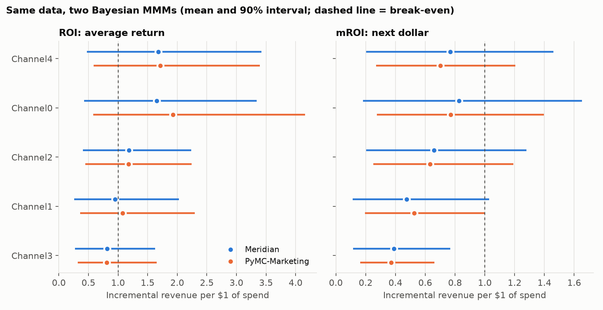

# Meridian vs PyMC-Marketing on the same data (generated by scripts/compare_pymc.py; do not edit by hand)

Both models are Bayesian marketing-mix models fitted to Meridian's simulated `geo_all_channels.csv`. Intervals are 90% posterior intervals. The data are simulated, and the true channel effects are not published, so this compares two models with each other, not with the truth.

## How the two models are set up

| | Meridian 2.1.0 | PyMC-Marketing 1.4.0 |
|---|---|---|
| Data | 40 geos x 156 weeks, revenue = conversions x revenue per conversion | same rows and columns |
| Paid media input | impressions (spend used for ROI) | spend; cost per impression is constant per channel here, so the two differ by a fixed factor |
| Carryover | geometric adstock, lags 0-8, decay ~ Uniform(0, 1) | same (`GeometricAdstock(l_max=9)`, decay ~ Beta(1, 1)) |
| Saturation | Hill, slope fixed at 1, half-saturation ~ TruncatedNormal(0.8, 0.8, 0.1, 10) x median media | same curve (Michaelis-Menten); the same prior, rescaled to the max-scaled inputs |
| Geo pooling | channel effect log-normal across geos around a national level, spread ~ HalfNormal(1) | same |
| Scaling | per capita | each geo divided by its own maximum (`DataDerivedScaling(dims=())`); the library default for a geo model is one national maximum |
| Time effect | national, 66 knots chosen automatically, linear interpolation, knot values ~ Normal(0, 5) | the same 66 knots and weights as a custom additive effect, each basis column centred over the fit period, knot values ~ zero-sum Normal(0, 0.5) on the max-scaled target |
| Controls | 2 controls, the promotion as a non-media treatment, the organic channel with its own adstock and Hill curve | 2 controls and the promotion as controls (geo-varying around a national mean), the organic channel as a media channel without ROI |
| Noise | one Normal scale for all geos | same |
| ROI prior | ROI ~ LogNormal(0.2, 0.9) on every paid channel (Meridian's ROI parameterization) | no ROI parameterization: each channel's effect prior is set so that the ROI it implies has the same median (1.22) and log-scale sd (0.90); see `prior_calibration.csv` |
| Sampler | NUTS (TensorFlow Probability on JAX), 4 chains x 1,000 kept draws | NUTS (nutpie), 4 chains x 1,000 draws after 1,500 tuning steps, target acceptance 0.99 |

## Convergence and fit

| | Meridian | PyMC-Marketing |
|---|---:|---:|
| Max R-hat (all parameters) | 1.168 | 1.042 |
| Divergent transitions | not reported by Meridian | 7 |
| Smallest bulk effective sample size | not computed | 97 |
| Sampling time on this laptop | 16 min | 6.0 min |
| National weekly revenue: R-squared | 0.771 | 0.772 |
| National weekly revenue: MAPE | 2.7% | 2.7% |

## ROI and mROI by channel

| Channel | Share of spend | ROI: Meridian | ROI: PyMC-Marketing | mROI: Meridian | mROI: PyMC-Marketing |
|---|---:|---|---|---|---|
| Channel0 | 18% | 1.66 [0.43, 3.34] | 1.93 [0.58, 4.16] | 0.83 [0.18, 1.65] | 0.77 [0.28, 1.40] |
| Channel1 | 14% | 0.95 [0.26, 2.03] | 1.08 [0.36, 2.29] | 0.48 [0.11, 1.03] | 0.52 [0.20, 1.00] |
| Channel2 | 6% | 1.18 [0.40, 2.24] | 1.18 [0.45, 2.24] | 0.66 [0.20, 1.28] | 0.63 [0.25, 1.19] |
| Channel3 | 40% | 0.82 [0.28, 1.62] | 0.81 [0.32, 1.65] | 0.39 [0.12, 0.77] | 0.37 [0.16, 0.66] |
| Channel4 | 22% | 1.68 [0.47, 3.42] | 1.72 [0.59, 3.40] | 0.77 [0.20, 1.46] | 0.70 [0.27, 1.21] |
| **All paid channels** | 100% | 1.20 [0.80, 1.67] | 1.27 [0.83, 1.88] | | |

Incremental revenue from paid media: Meridian $263.2M [$174.9M, $367.6M], PyMC-Marketing $278.8M [$182.3M, $411.7M], on $219.5M of spend (20.0% and 21.1% of revenue).

## Do the business conclusions agree?

- **Ranking by ROI.** Meridian: Channel4, Channel0, Channel2, Channel1, Channel3. PyMC-Marketing: Channel0, Channel4, Channel2, Channel1, Channel3. Spearman rank correlation 0.90.
- **Ranking by mROI.** Meridian: Channel0, Channel4, Channel2, Channel1, Channel3. PyMC-Marketing: Channel0, Channel4, Channel2, Channel1, Channel3. Spearman rank correlation 1.00.
- **Is every channel's next dollar below break-even (mROI < 1)?** Meridian: yes. PyMC-Marketing: yes.
- **PyMC-Marketing's mean ROI falls inside Meridian's 90% interval** for 5 of 5 channels.
- **Cut every paid channel by 10%** (saves $21.9M). Revenue lost: Meridian $13.4M [$9.0M, $18.3M], PyMC-Marketing $12.8M [$9.2M, $16.9M]. Share of draws in which the revenue lost is smaller than the spend saved: Meridian 99.7%, PyMC-Marketing 100.0%.
- **Move 10% of Channel3's budget to Channel0** (the move in the Meridian report, $8.8M). Change in revenue: Meridian $3.0M [−$3.6M, $10.4M], P(gain) 73.7%; PyMC-Marketing $2.7M [−$2.3M, $8.3M], P(gain) 79.4%.

## Carryover (adstock half-life, weeks)

| Channel | Meridian | PyMC-Marketing | Weight after 1 week: Meridian | PyMC-Marketing |
|---|---:|---:|---:|---:|
| Channel0 | 5.0 | 3.8 | 0.81 | 0.78 |
| Channel1 | 2.0 | 2.2 | 0.66 | 0.68 |
| Channel2 | 0.8 | 0.8 | 0.41 | 0.41 |
| Channel3 | 1.2 | 1.0 | 0.50 | 0.48 |
| Channel4 | 5.4 | 5.0 | 0.84 | 0.84 |
| Organic_channel0 | 1.4 | 2.2 | 0.58 | 0.68 |

## The ROI prior in each model

Meridian: LogNormal(0.2, 0.9) for every paid channel, median 1.22, 90% interval [0.28, 5.37].

PyMC-Marketing (implied by the effect priors; 20,000 prior draws per channel):

| Channel | Prior ROI median | 5th percentile | 95th percentile | sd of log ROI |
|---|---:|---:|---:|---:|
| Channel0 | 1.22 | 0.39 | 6.42 | 0.90 |
| Channel1 | 1.22 | 0.39 | 6.45 | 0.90 |
| Channel2 | 1.22 | 0.40 | 6.57 | 0.90 |
| Channel3 | 1.22 | 0.39 | 6.39 | 0.90 |
| Channel4 | 1.22 | 0.39 | 6.40 | 0.90 |

The medians and log-scale spreads match; the shapes differ a little (PyMC-Marketing's implied prior is not exactly log-normal).
